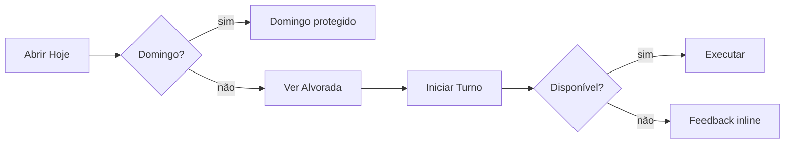
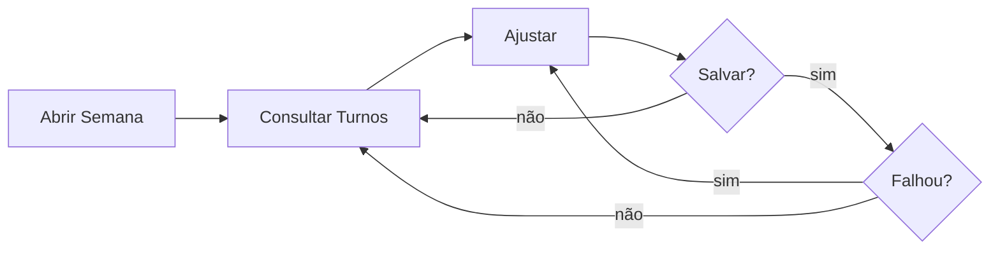
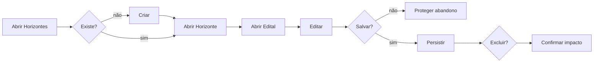
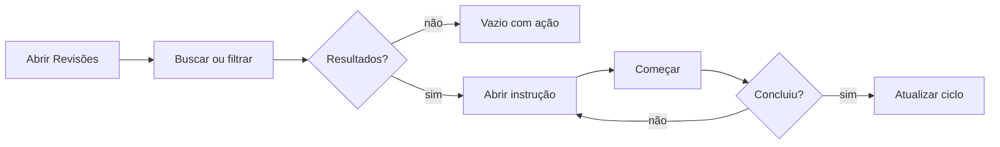
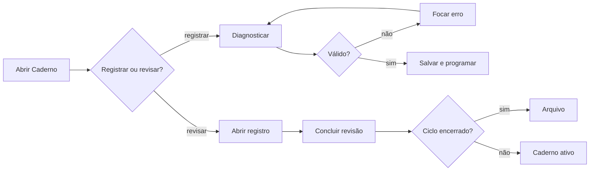

# Jornadas do produto

Estes são os únicos fluxos de produto disponíveis para extensão. Cada diagrama mostra o caminho feliz e o desvio recuperável.

## Alvorada do dia

## Esta semana

## Horizontes e Edital

## Revisões programadas

## Caderno de Erros

